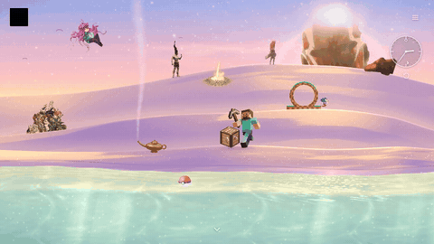
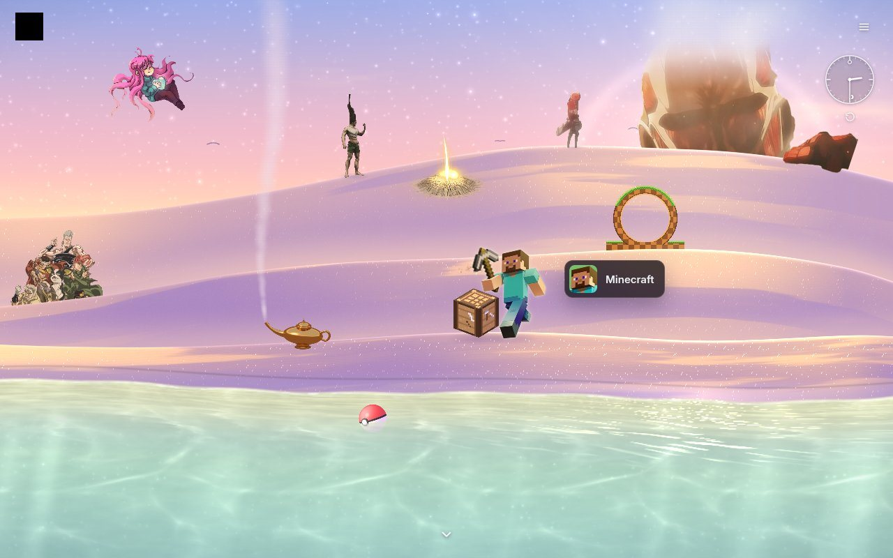
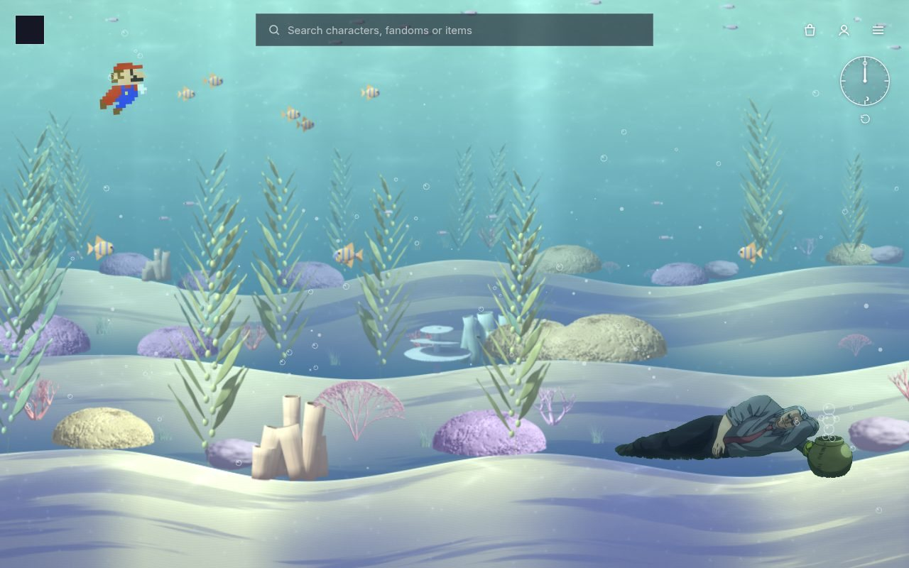
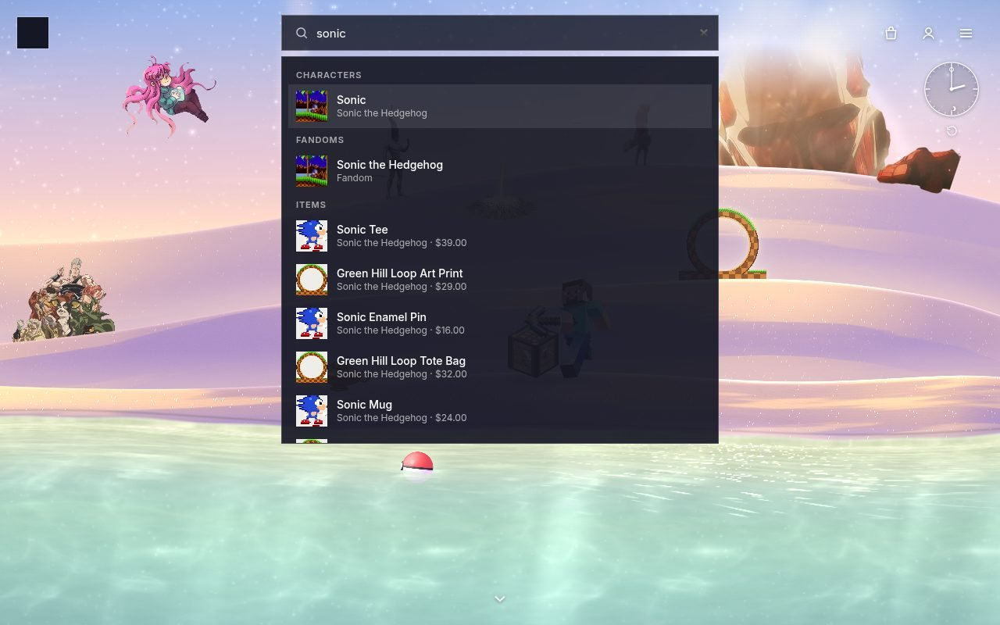
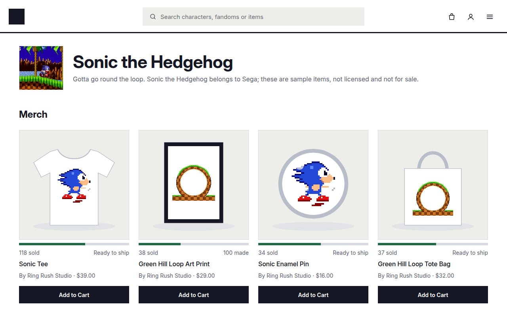
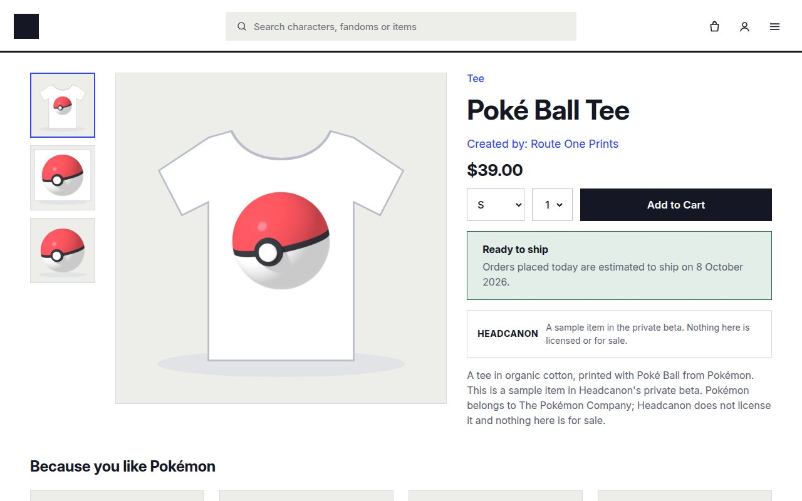
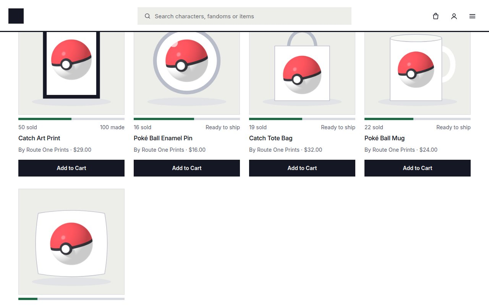
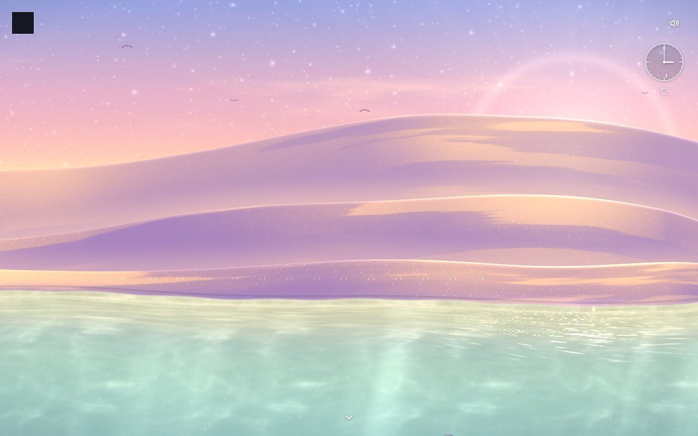

# Headcanon

**A fictional-first marketplace and licensing platform.** Makers sell physical and digital objects from original worlds; rights holders review what gets made; buyers shop by fandom. Think Etsy, but with licensing built into the product instead of bolted on.

I founded and built it solo. The application source is private while the project is pre-launch; this repository is the public showcase. The code is available on request.

▶ **[Watch the desert world demo](https://tacogod900.github.io/headcanon/demo.mp4)** · 🏝️ **[Try the desert (proof of concept)](https://tacogod900.github.io/headcanon-desert/)** · 🌐 [My portfolio](https://tacogod900.github.io) · [Earlier 5-minute walkthrough](https://www.loom.com/share/540d6dbd1be54ce28ee9439d2786e891)

## The desert world

Headcanon's new front door is one painted, animated desert where every fandom lives as a character in its own native style: anime cut-outs, 16-bit pixel sprites, Blender-modelled objects. Hover a character and its name assembles out of pixels beside a picture of its fandom; click it and the page fades to white into that fandom's shop. Search finds characters, fandoms and items, and over the desert the matching character lights up.

- **Rendered live in WebGL2.** One shared fragment shader paints the sky, three dune bands, the water and the seabed; the sky changes with your real time of day (drag the clock to change it), and it stays surreal at every hour.
- **A beach that behaves.** Swells roll in, break and run up the sand, and the wave sound is scheduled on the audio clock to match. Clicking the water ripples the surface itself; clicking sand kicks a few grains that land behind nearer dunes.
- **A reef below.** Scroll down and the view splashes through the surface into a reef of Blender-modelled coral, kelp that sways as the cursor passes, and fish that scatter from it. Sound muffles underwater; holding the mouse streams bubbles.
- **Characters in their own style, lit by the scene.** Madeline's hair drifts, Steve works at a crafting table, Sonic runs a Green Hill loop, Mario swims laps, Morel's bubble soldiers march up from his pipe and pop when the cursor touches them, and a Site of Grace flickers on the far dune.
- **All sound is synthesised in the browser.** Wind, waves, splashes, bubbles and UI ticks, with no audio files.

Behind the desert is a clean, Makeship-style shop: fandom pages, product pages with one Add to Cart, "Because you like…" and "Similar to this" rows, and the cart and checkout of the existing marketplace. On staging and production the homepage is the empty beach: the same scene with no characters, all Headcanon's own art.

*The desert's characters belong to their owners; the proof of concept is a non-commercial preview and the shop's items are samples, not for sale.*

## Screenshots

| The desert world | Under the surface |
| --- | --- |
|  |  |

| Search lights up the character | A fandom page |
| --- | --- |
|  |  |

| Product page | Because you like… |
| --- | --- |
|  |  |

| The empty beach (staging) | Maker studio |
| --- | --- |
|  |  |

*All shops, makers, worlds and sales shown are synthetic review data.*

## What it does

- **Storefront**: fandom-scoped search, discovery, categories, collections, gift cards, drops and preorders.
- **Commerce**: cart, checkout, orders, buyer account and case flows.
- **Makers**: seller onboarding, studio pages, listing management and an operations workspace.
- **Rights holders**: a review and approval workflow for licensed worlds, separate from maker tooling.
- **Admin**: a narrow admin foundation for marketplace operations.
- **Review profile**: a deterministic, fictional "Lantern World" seed with a protected reviewer gate and one-click demo reset.

## How it's built

| Layer | Choice |
| --- | --- |
| UI | React 19 with server components, on [Vinext](https://github.com/cloudflare/vinext) (Next.js-style app router on Vite) |
| Runtime | Cloudflare Workers entry point, developed locally with Miniflare |
| Data | Cloudflare D1 with Drizzle ORM migrations and schema projections |
| Styling | Tailwind CSS and a token-only design layer |
| Graphics | WebGL2 and GLSL for the desert; Blender (scripted from Python) for its models |
| Language | TypeScript throughout, strict ESLint with a11y rules |
| Tests | 280+ test files across unit, integration, routed HTTP, permissions, durable (D1) and end-to-end suites |

Engineering practices I used on this project:

- A canonical roadmap of 99 tracked tasks, each accepted with evidence, plus a 128-capability marketplace completeness manifest.
- A single `verify:accepted` gate that runs tests, type-checking, lint, readability, migration coverage, build and generated-file hygiene.
- Runtime profiles (`local`, `test`, `review`, `production`) as application authority, independent of `NODE_ENV`, so review builds can never inherit production permissions.
- Security, performance, test-coverage and production-readiness audits kept in the repo alongside the code.

## Status

Pre-launch prototype. The accepted pilot runs as a private review build with synthetic data; no real payments, licences or rights-holder agreements are active yet.
