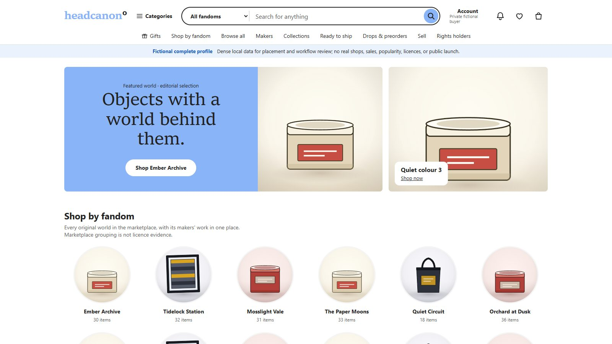
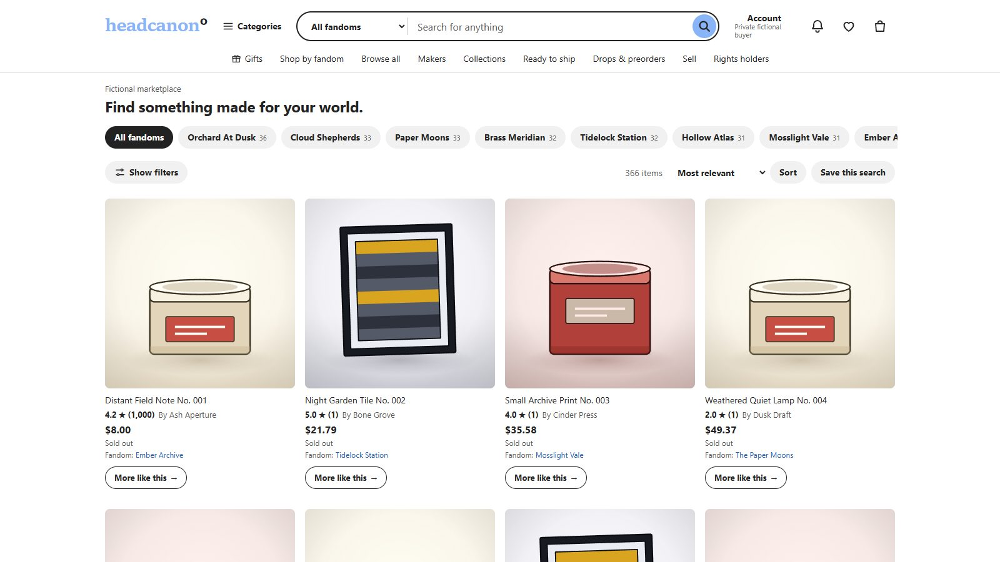
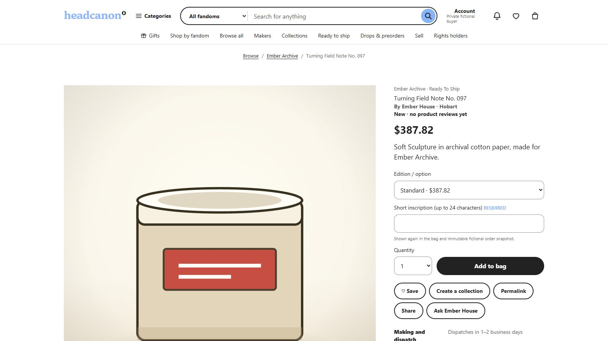
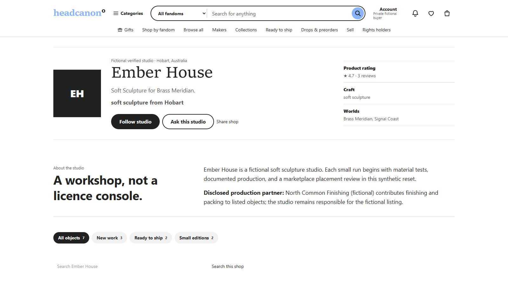

# Headcanon

**A fictional-first marketplace and licensing platform.** Makers sell physical and digital objects from original worlds; rights holders review what gets made; buyers shop by fandom. Think Etsy, but with licensing built into the product instead of bolted on.

I founded and built it solo. The application source is private while the project is pre-launch; this repository is the public showcase. The code is available on request.

▶ **[Watch the 5-minute demo](https://www.loom.com/share/540d6dbd1be54ce28ee9439d2786e891)** · 🌐 [My portfolio](https://tacogod900.github.io)

## Screenshots

| Storefront home | Discover |
| --- | --- |
|  |  |

| Listing page | Maker studio |
| --- | --- |
|  |  |

*All shops, makers, worlds and sales shown are synthetic review data.*

## What it does

- **Storefront**: fandom-scoped search, discovery, categories, collections, gift cards, drops and preorders.
- **Commerce**: cart, checkout, orders, buyer account and case flows.
- **Makers**: seller onboarding, studio pages, listing management and an operations workspace.
- **Rights holders**: a review and approval workflow for licensed worlds, separate from maker tooling.
- **Admin**: a narrow admin foundation for marketplace operations.
- **Review profile**: a deterministic, fictional "Lantern World" seed with a protected reviewer gate and one-click demo reset.

## How it's built

| Layer | Choice |
| --- | --- |
| UI | React 19 with server components, on [Vinext](https://github.com/cloudflare/vinext) (Next.js-style app router on Vite) |
| Runtime | Cloudflare Workers entry point, developed locally with Miniflare |
| Data | Cloudflare D1 with Drizzle ORM migrations and schema projections |
| Styling | Tailwind CSS |
| Language | TypeScript throughout, strict ESLint with a11y rules |
| Tests | 280+ test files across unit, integration, routed HTTP, permissions, durable (D1) and end-to-end suites |

Engineering practices I used on this project:

- A canonical roadmap of 99 tracked tasks, each accepted with evidence, plus a 128-capability marketplace completeness manifest.
- A single `verify:accepted` gate that runs tests, type-checking, lint, readability, migration coverage, build and generated-file hygiene.
- Runtime profiles (`local`, `test`, `review`, `production`) as application authority, independent of `NODE_ENV`, so review builds can never inherit production permissions.
- Security, performance, test-coverage and production-readiness audits kept in the repo alongside the code.

## Status

Pre-launch prototype. The accepted pilot runs as a private review build with synthetic data; no real payments, licences or rights-holder agreements are active yet.
